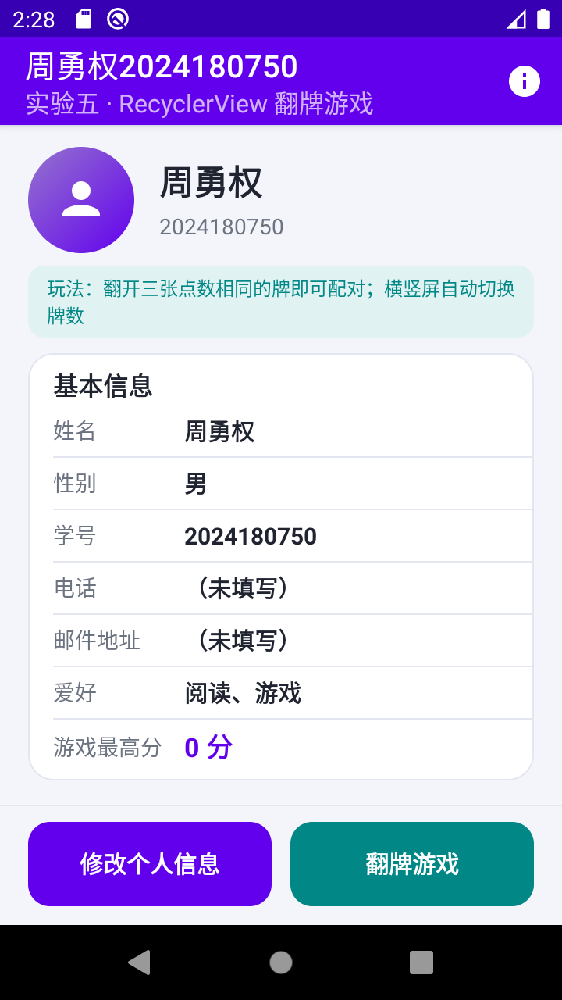
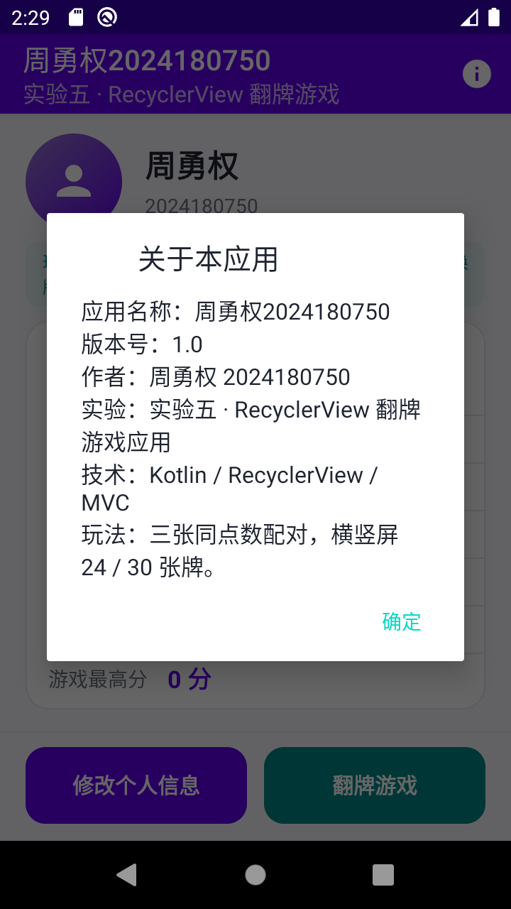
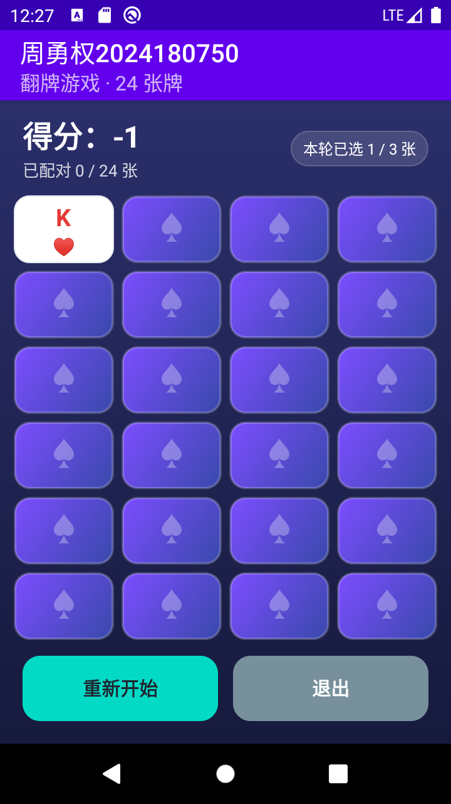
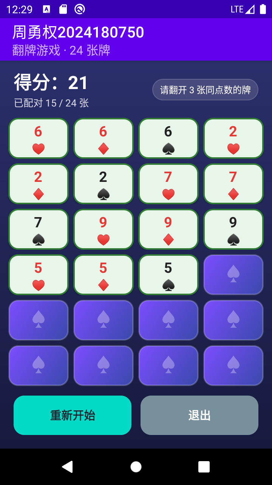
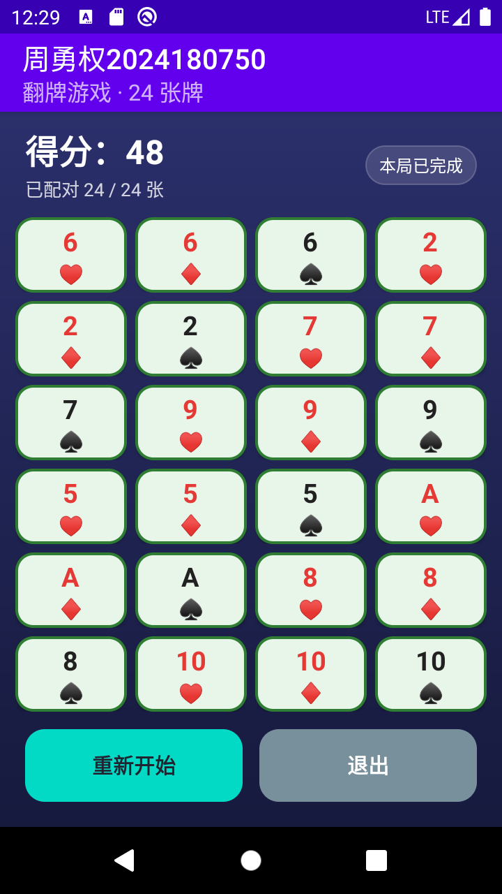
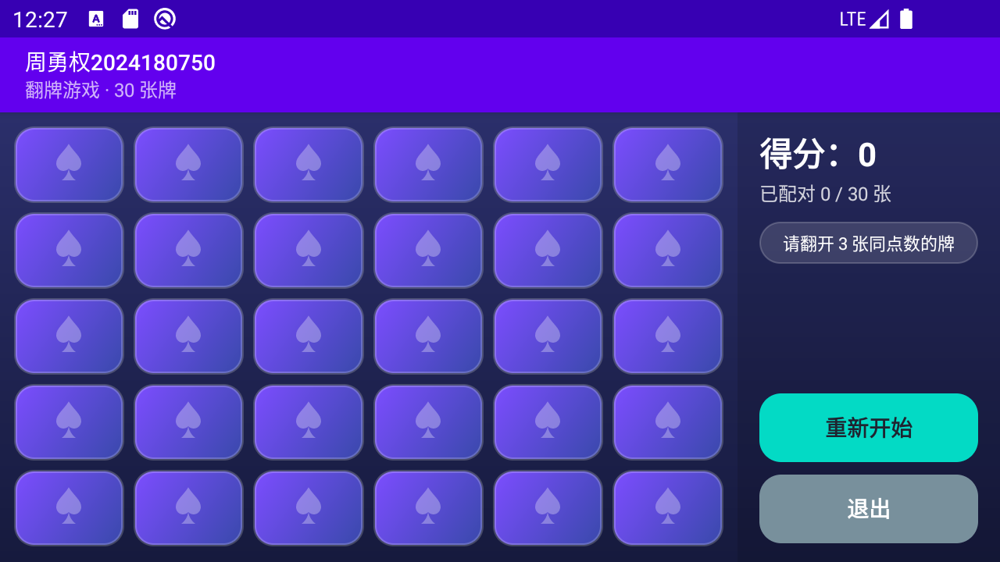

# RecyclerView 翻牌游戏（实验五）

Android 移动应用开发 实验五作业：在实验四翻牌游戏的基础上，用 **RecyclerView + GridLayoutManager**
重构游戏界面，实现 **24 张牌的三张配对玩法**，并加入 **选项菜单 / 关于对话框**、
模型 **reset()** 方法和 **横竖屏不同牌数** 支持。

- 应用标题：**周勇权2024180750**（提交要求：APP 标题为「姓名+学号」）
- 包名：`cn.edu.sicnu.cardgame`
- 语言：Kotlin + XML 布局，MVC 分层
- 最低版本：Android 7.0（API 24）；编译版本：API 37
- 代码托管：[GitHub - zyongquan/Android_CardFlipGame](https://github.com/zyongquan/Android_CardFlipGame)
- 分支：`main`（实验四版本） / `Dev`（实验五版本，本分支）

## 运行截图

<p align="center">
  
  
  
</p>

<p align="center">
  
  
  
</p>

> 截图由 Android 10（API 29）模拟器实际运行截取；竖屏 720×1280、横屏 1280×720。

## 实验要求与完成情况

| 实验要求 | 实现方式 |
| --- | --- |
| 在实验四基础上新建 `Dev` 分支完成实验五 | 从实验四 `main` 新建 `Dev` 分支，实验五代码提交到 `Dev`，`main` 保持实验四版本 |
| MainActivity 添加菜单，点击弹出关于对话框 | `menu_main.xml` + `onCreateOptionsMenu()` + `MaterialAlertDialogBuilder` |
| RecyclerView 实现 24 张牌游戏，界面规整美观 | `RecyclerView` + `GridLayoutManager`（4 列 × 6 行），自适应牌高，一屏完整显示 |
| 适配器从 `RecyclerView.Adapter` 派生，重载方法并处理回调 | `CardAdapter` 重写 `getItemCount / onCreateViewHolder / onBindViewHolder`，通过 `OnCardClickListener` 回调点击位置 |
| `CardMatchingGame` 添加 `reset()` | `reset(count)` 清空得分、选择状态并重新发牌 |
| 横竖屏不同牌数 | `values/integers.xml`（24 张 / 4 列）+ `values-land/integers.xml`（30 张 / 6 列） |
| 三张牌游戏，只修改 `chooseCardAtIndex` 与 `Card.match` | 三张同点数判定、三张一组发牌、撤销选择、得分与配对状态更新 |
| 使用字符串资源，不在布局 / 代码中硬编码文案 | 所有界面文案、Toast、对话框、无障碍描述均在 `strings.xml` 中 |
| 主题兼容按钮背景 | `Theme.MaterialComponents.DayNight.DarkActionBar.Bridge` + 自定义圆角按钮样式 |

## 功能说明

### 主界面与菜单

- 显示玩家姓名、性别、学号、电话、邮件、爱好和游戏最高分；
- ActionBar 右侧的「关于」菜单项点击后弹出应用信息对话框；
- 两个入口分别进入「个人信息修改」和「翻牌游戏」。

### 三张配对翻牌游戏

- 竖屏：**24 张牌（4 列 × 6 行）**；横屏：**30 张牌（6 列 × 5 行）**；
- 每翻开一张牌扣 1 分；连续翻开 3 张后判定：
  - 三张点数相同：`3 × MATCH_BONUS(4) = 12` 分，三张牌标记为已配对；
  - 三张点数不同：扣 `MISMATCH_PENALTY(2)` 分，三张牌全部盖回；
- 点击本轮已经翻开的牌可以撤销选择，不额外扣分；
- 「重新开始」调用 `CardMatchingGame.reset()`；「退出 / 返回」把最高分回传给主界面；
- 每张牌使用 `flip_container` 绕 Y 轴旋转实现翻牌动画，已配对牌显示绿色描边。

### 横竖屏适配

`CardGameActivity` 在 `onCreate()` 中通过 `resources.getInteger(R.integer.card_count)` 读取当前方向对应的
牌数，旋转屏幕时 Activity 重建并自动加载 `values-land` 中的 30 张牌；同时根据 RecyclerView 的可用高度
计算每张牌的高度，使 24 / 30 张牌都能在一屏内完整显示。

## MVC 分层

| 层次 | 文件 | 职责 |
| --- | --- | --- |
| Model | `Card.kt`、`Deck.kt`、`CardMatchingGame.kt` | 扑克牌、三张一组发牌、三张配对规则、得分与 `reset()` |
| Model | `Player.kt`、`PlayerRepository.kt` | 玩家信息 + 进程内仓库（3 个 Activity 共享） |
| View | `res/layout/*.xml`、`CardAdapter.kt` | 界面布局；适配器把牌的 `isChosen / isMatched` 渲染成牌背 / 牌面 / 已配对样式并播放动画 |
| Controller | `MainActivity.kt`、`CardGameActivity.kt`、`PersonalInfoActivity.kt` | 加载菜单、接收点击、调用模型、刷新界面、Activity 之间回传数据 |

调用关系：用户点击牌面 → `CardAdapter.OnCardClickListener` 回调 → `CardGameActivity.onCardClick()` →
`CardMatchingGame.chooseCardAtIndex()` → `adapter.refresh()` + `updateHud()`。Model 不依赖任何 Android UI 类。

## 目录结构

```
app/src/main/
├── java/cn/edu/sicnu/cardgame/
│   ├── Card.kt                  # 模型：一张牌，三张同点数 match()
│   ├── Deck.kt                  # 模型：52 张牌堆，三张一组发牌
│   ├── CardMatchingGame.kt      # 模型：三张配对规则、reset()
│   ├── CardAdapter.kt           # 视图：RecyclerView.Adapter + 点击回调 + 翻牌动画
│   ├── CardGameActivity.kt      # 控制器：牌数/列数、自适应牌高、游戏交互
│   ├── MainActivity.kt          # 控制器：主界面 + 选项菜单 + 关于对话框
│   ├── PersonalInfoActivity.kt  # 控制器：个人信息修改
│   └── Player.kt / PlayerRepository.kt
├── res/
│   ├── layout/                  # 竖屏布局 activity_main / activity_card_game / item_card
│   ├── layout-land/             # 横屏布局 activity_card_game
│   ├── menu/menu_main.xml       # 「关于」菜单
│   ├── values/                  # strings / colors / themes / integers（24 张、4 列）
│   ├── values-land/             # integers（30 张、6 列）
│   └── drawable/                # 牌背、牌面、已配对、按钮、菜单图标等
├── src/test/                    # JVM 单元测试：Card / Deck / CardMatchingGame
└── src/androidTest/             # Espresso 界面测试：3 个 Activity
```

## 运行与测试

```bash
./gradlew :app:assembleDebug            # 编译 Debug APK
./gradlew :app:testDebugUnitTest        # 27 个 JVM 单元测试
./gradlew :app:connectedDebugAndroidTest # 14 个 Espresso 界面测试（需模拟器 / 真机）
```

测试结果：单元测试 **27 / 27 通过**，界面测试 **14 / 14 通过**。

## Git 仓库

- `main`：实验四翻牌游戏版本；
- `Dev`：实验五 RecyclerView 版本（本分支）；
- 实验五代码提交在 `Dev` 分支，`main` 保持不变。

## 作者

周勇权 2024180750 · 计算机科学学院
