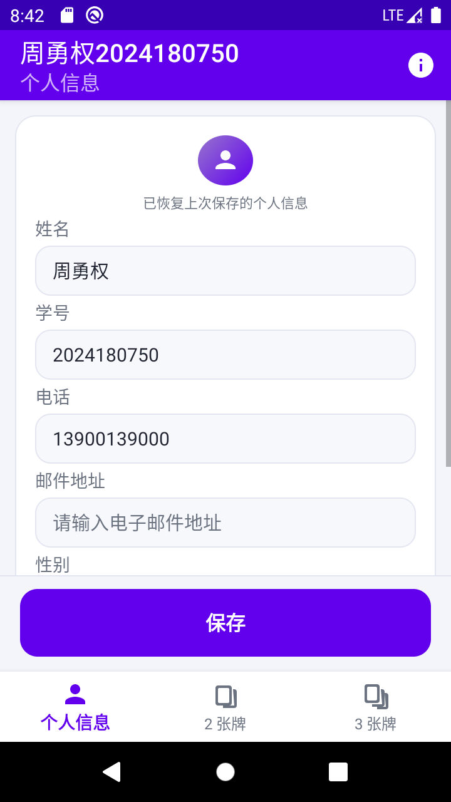
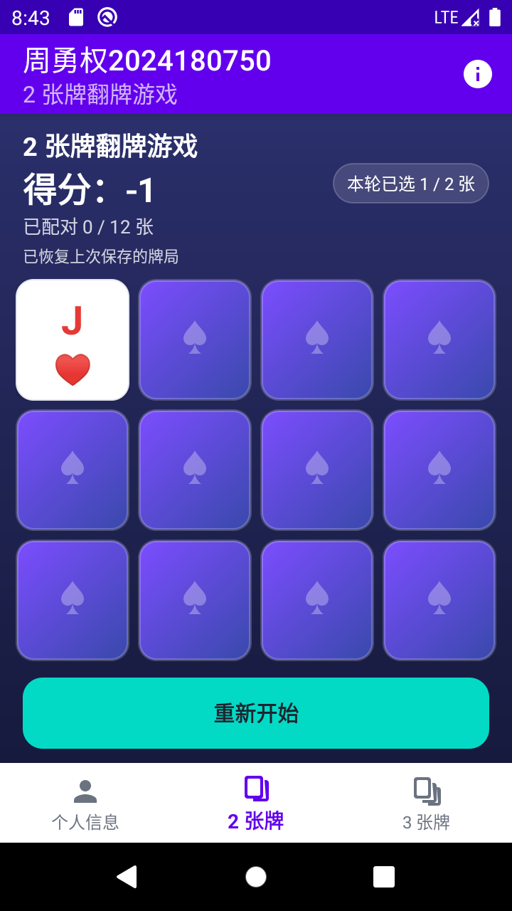
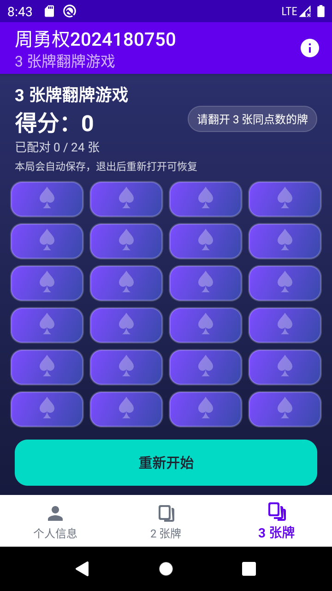

# 多 Fragment 应用（实验六）

Android 移动应用开发 实验六：在实验五 RecyclerView 翻牌游戏的基础上，用 **3 个 Fragment**
重构 APP，并通过 **对象序列化 + 文件存储** 保存个人信息和两种牌局，退出程序后重新打开可以恢复。

- 应用标题：**周勇权2024180750**（提交要求：APP 标题为「姓名+学号」）
- 包名：`cn.edu.sicnu.cardgame`
- 语言：Kotlin + XML 布局
- 最低版本：Android 7.0（API 24）；编译版本：API 37
- 代码仓库：[GitHub - zyongquan/Android_CardFlipGame](https://github.com/zyongquan/Android_CardFlipGame)
- 分支：`main`（实验五最终版本）/ `Dev`（实验五开发分支）/ `Frag`（实验六，本分支）

## 运行截图

<p align="center">
  
  
  
</p>

> 截图由 Android 10（API 29）模拟器实际运行截取，竖屏 720 × 1280。

## 实验要求与完成情况

| 实验要求 | 实现方式 |
| --- | --- |
| 在实验五 `Dev` 分支上新建 `Frag` 分支 | 从 `Dev` 新建 `Frag`，实验六代码提交在 `Frag` 分支 |
| 最少实现 3 个 Fragment | `PersonalInfoFragment`、`TwoCardGameFragment`、`ThreeCardGameFragment` |
| 第 1 个 Fragment 是个人信息 | 姓名、学号、电话、邮箱、性别、爱好，可保存并恢复 |
| 第 2 个 Fragment 是 2 张牌翻牌游戏 | 12 张牌、4 列，同点数两张配对，得分 16 分 |
| 第 3 个 Fragment 是 3 张牌翻牌游戏 | 24 张牌、4 列，同点数三张配对，得分 12 分 |
| 个人信息采用序列化存储 | `Player implements Serializable`，`PlayerStore` 用 `ObjectOutputStream/ObjectInputStream` 读写 `player.dat` |
| 翻牌游戏采用序列化存储 | `CardMatchingGame implements Serializable`，`GameStore` 保存 `two_card_game.dat` / `three_card_game.dat` |
| 退出程序后再打开可恢复 | 个人信息和牌局在点击/`onStop()` 时保存，重新创建 Fragment 时读取恢复 |
| 读文件 `openFileInput`、写文件 `openFileOutput` | `PlayerStore`、`GameStore` 均使用应用私有文件接口 |

## 三个 Fragment

| Fragment | 功能 | 存档文件 |
| --- | --- | --- |
| `PersonalInfoFragment` | 编辑姓名、学号、电话、邮箱、性别、爱好并保存 | `player.dat` |
| `TwoCardGameFragment` | 2 张同点数配对，12 张牌（4 × 3） | `two_card_game.dat` |
| `ThreeCardGameFragment` | 3 张同点数配对，24 张牌（4 × 6） | `three_card_game.dat` |

`MainActivity` 只作为宿主，使用 `BottomNavigationView` 在三个 Fragment 之间切换；
每个 Fragment 的界面、交互和存档逻辑相互独立。

## 序列化与文件存储

1. `Player`、`Card`、`CardMatchingGame` 实现 `java.io.Serializable`，并显式声明 `serialVersionUID`。
2. `PlayerStore`：
   - `openFileOutput("player.dat", MODE_PRIVATE)` + `ObjectOutputStream` 保存 `Player`；
   - `openFileInput("player.dat")` + `ObjectInputStream` 读取 `Player`。
3. `GameStore`：
   - 每次翻牌、重新开始、切换 Fragment 或 `onStop()` 时保存整个 `CardMatchingGame`，
     包括牌面、得分、已配对状态和本轮选择；
   - 再次打开时恢复完整牌局，而不只是最高分。
4. 文件读取失败、文件不存在或版本不匹配时回退到新牌局 / 默认个人信息，不会崩溃。

## 游戏规则

- 每翻开一张牌扣 1 分；
- 2 张牌玩法：两张点数相同加 16 分，两张不同扣 2 分并盖回；
- 3 张牌玩法：三张点数相同加 12 分，否则扣 2 分并全部盖回；
- 点击本轮已翻开的牌可以撤销选择；
- 「重新开始」重新发牌并清零得分。

## 目录结构

```
app/src/main/
├── java/cn/edu/sicnu/cardgame/
│   ├── MainActivity.kt              # Fragment 容器 + BottomNavigationView + 关于菜单
│   ├── PersonalInfoFragment.kt      # 个人信息 Fragment
│   ├── TwoCardGameFragment.kt       # 2 张牌游戏 Fragment
│   ├── ThreeCardGameFragment.kt     # 3 张牌游戏 Fragment
│   ├── BaseCardGameFragment.kt      # 两种牌局共用的 RecyclerView、计分和保存逻辑
│   ├── Card.kt / Deck.kt            # 牌与牌堆（Serializable）
│   ├── CardMatchingGame.kt          # 通用配对模型（2 / 3 张，Serializable）
│   ├── CardAdapter.kt               # RecyclerView 适配器与点击回调
│   ├── Player.kt                    # 玩家模型（Serializable）
│   ├── PlayerStore.kt               # player.dat 读写
│   └── GameStore.kt                 # 两种牌局文件读写
├── res/layout/
│   ├── activity_main.xml            # Fragment 容器 + 底部导航
│   ├── fragment_personal_info.xml
│   ├── fragment_card_game.xml       # 两种牌局共用
│   └── item_card.xml
├── res/menu/menu_bottom_nav.xml
├── res/color/bottom_nav_item_color.xml
└── res/values/strings.xml
```

## 运行与测试

```bash
./gradlew :app:assembleDebug
./gradlew :app:testDebugUnitTest          # 35 个 JVM 单元测试
./gradlew :app:connectedDebugAndroidTest  # 5 个 Espresso 界面测试
```

测试结果：单元测试 **35 / 35 通过**，界面测试 **5 / 5 通过**。

## Git 分支

- `main`：实验五合并后的版本；
- `Dev`：实验五开发分支；
- `Frag`：实验六多 Fragment 版本（本分支）。

实验六代码只提交到 `Frag` 分支，未修改 `main` 和 `Dev`。

## 作者

周勇权 2024180750 · 计算机科学学院
